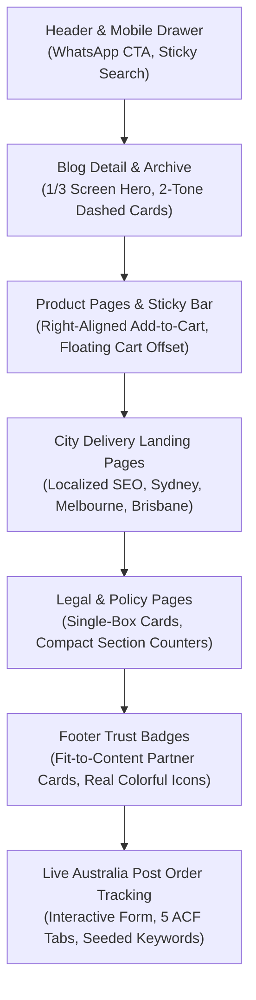

# Working with Steve: Waklert Australia Project Guide & Collaboration Memory

> **Purpose:** This document captures the complete operational memory, developer profile, project evolution, and strict engineering standards established while building **Waklert Australia** (`waklertaustralia.com`) with **Steve**. Any AI agent or developer continuing this project must read and strictly adhere to this guide.

---

## 1. Developer Profile: Who is Steve?

### The Mindset
Steve is a fast-paced, highly pragmatic product owner and lead developer. He does not want verbose lectures, abstract theorizing, or unexecuted plans. He values:
- **Instant Understanding:** Grasping the exact UI or architectural intent from a single phrase or screenshot.
- **Speed & Precision:** Executing changes cleanly on the first try without introducing visual regressions or broken layouts.
- **Zero Fluff:** Keeping communication short, sharp, and results-focused.
- **Total Editability:** Empowering him to manage every piece of content dynamically via WordPress Admin without touching template code.

### Steve's Communication Patterns
Analyzing his chat messages across this project reveals distinct signatures:

| Phrasing / Pattern | Context / Meaning | Required Agent Action |
|---|---|---|
| `"bro remember in your life to not make it hardcoded!!!!!"` | The #1 Cardinal Rule: Never hardcode text or structure in PHP templates. | Register full ACF fields/subfields, seed default values into postmeta, and read exclusively via ACF in templates. |
| `"bro padding y still too big for all the sections"` | Spacing is too loose / excessive vertical whitespace. | Immediately cut `py-*` values down (e.g., `py-16` / `py-12` &rarr; `py-6` / `py-8`). Keep content tight. |
| `"bro delete the divider please, i don't want each point has too big gap"` | Section dividers or horizontal lines are visually disconnecting content. | Remove `
` and divider borders; unify items into a cohesive card or flow. |
| `"fix the color of track my order please, because there is still like green, etc"` | Off-brand or default framework colors were accidentally introduced. | Strip out foreign colors (greens/teals); strictly apply brand Navy (`#0c4161`), Sky Blue, Amber (`#f59e0b`), or AusPost Red (`#dc2626`). |
| `"change here icon to the real icon with the colorful icon"` | Monochrome / placeholder SVGs look cheap or generic. | Embed high-fidelity, authentic, colorful SVGs (e.g. real Australia Post logo, card brands, verified badges). |
| `"in footer, make this fit to content"` | Container is stretching full width unnecessarily. | Apply `w-fit`, `inline-flex`, or tight content-hugging widths instead of `w-full`. |
| `"broh you must place the button add to cart to the right side not center! Just add some mor padding right"` | Sticky CTA bar is blocking or colliding with mobile floating widgets. | Align action button to the right and add right-side clearance padding for floating carts or chat bubbles. |
| `"push now"` | Immediate deployment directive. | Build assets (`npm run build`), commit with conventional message, push branch, open PR, and merge to `main`. |
| `"also fill up the keyword please"` | Admin fields or repeaters are empty. | Seed database records (`postmeta`) so the WP Admin editor displays populated rows out of the box. |

---

## 2. The 5 Commandments of Working with Steve

### I. The Zero-Hardcoding Manifesto
> *"bro remember in your life to not make it hardcoded!!!!! so i can still edit the content! fill it up from the wp admin"*

1. **Every string, link, badge, and step must be an ACF field.**
   - If an element appears on the screen, Steve must be able to change its wording, URL, or visibility from the WordPress Admin dashboard.
2. **Organize ACF Fields with Clean Tabs.**
   - In Flexible Content layouts (e.g. `layout_track_order`), group related fields using ACF `tab` fields (`Hero`, `Form Settings`, `Banner`, `Steps`, `Support & Trust`).
3. **Always Seed the Database on Layout Creation.**
   - Creating ACF JSON definitions is only half the job. Always seed the initial rows into `wp_postmeta` (with `_modules_0_*` field key references) so that when Steve opens WP Admin, **the fields and repeater rows are already populated** rather than showing empty blanks.
4. **Resilient Fallbacks in PHP.**
   - Always write fallback logic in PHP templates (`get_sub_field('heading') ?: 'Default Heading'`) so that even if a field is newly added, the page never renders blank or throws PHP errors.

### II. Compact Vertical Spacing (Tight `padding-y`)
> *"bro padding y still too big for all the sections"*

1. Keep container padding tight. Steve dislikes the modern SaaS trend of huge 96px–128px (`py-24` / `py-32`) gaps.
2. Preferred vertical padding scales:
   - Module top/bottom: `py-6` to `py-8` (24px &ndash; 32px).
   - Card inner padding: `p-4` to `p-6` (16px &ndash; 24px).
   - Component gaps: `gap-3` to `gap-4` (12px &ndash; 16px).
3. Do not insert artificial divider lines between closely related points. Keep information dense, readable, and grouped into clean rounded cards.

### III. Brand Palette Integrity
> *"fix the color of track my order please, because there is still like green, etc"*

Never introduce random colors or CSS framework defaults. Waklert Australia has a distinct, Australian-tailored pharmacy aesthetic:

| Color Name | Hex Code | Purpose & Usage |
|---|---|---|
| **Waklert Navy** | `#0c4161` | Main brand color, topbar, primary titles, dark buttons |
| **Ocean / Sky Blue** | `#0284c7` / `#0369a1` | Interactive elements, links, dashed borders, icons |
| **Australian Amber / Gold** | `#f59e0b` / `#d97706` | Primary action CTAs, highlight badges, star ratings |
| **Soft Blue Tint** | `#f0f7fc` / `#e0f2fe` | Backgrounds for callouts, cards, and sections |
| **Australia Post Red** | `#dc2626` / `#b91c1c` | Australia Post tracking badges and official carrier marks |
| **Dark Neutral Text** | `#1e293b` | High-contrast body copy |
| **Muted Slate** | `#64748b` | Subheadings, helper text, and timestamps |
| **WhatsApp Green** | `#25d366` | Strictly reserved for WhatsApp chat buttons and CTAs |

### IV. Visual Polish & Authentic Assets
1. **Real Icons:** Always use official, full-color SVGs for trusted third parties (Australia Post, Visa, Mastercard, Express Delivery badges).
2. **2-Tone Dashed Card Styling:** The signature visual motif across the site is the modern 2-tone dashed border container (`border-2 border-dashed border-[#0c4161]/20 bg-[#f0f7fc]/50 rounded-2xl`). Use this motif across cards, WYSIWYG tables, FAQ items, and delivery modules.
3. **Mobile Clearance:** When rendering fixed or sticky bottom elements (e.g. sticky Add to Cart), respect floating UI elements (such as `side-cart-woocommerce` and WhatsApp launcher) by providing appropriate right padding or right-side placement.

### V. Disciplined, Fast Git Workflow
1. Create a GitHub Issue first: `gh issue create --title "..." --body "..."`
2. Checkout feature branch: `git checkout -b <type>/<name>-<issue#>`
3. Build frontend assets if CSS/JS modified: `npm run build`
4. Commit with conventional commit messages: `feat:`, `fix:`, `style:`, `docs:`
5. Push branch: `git push origin <branch>`
6. Open Pull Request: `gh pr create --fill`
7. Merge PR: `gh pr merge --squash --delete-branch`
8. Return to `main` and pull: `git checkout main && git pull`

---

## 3. Waklert Australia Project: Architecture & History

### Project Background
Waklert Australia (`waklertaustralia.com`) is a dedicated Australian e-commerce platform offering premium Armodafinil (Waklert 150mg) and Modafinil products with rapid domestic delivery via Australia Post. The site was re-engineered from a legacy template structure into a high-converting, mobile-first Australian pharmacy storefront.

### Core Architecture
- **Theme Location:** `wp-content/themes/waklertaustralia.com-wp/`
- **Frontend Stack:** Tailwind CSS + PostCSS + Vite/NPM build pipeline, vanilla JavaScript for interactive components.
- **Backend Architecture:** Native WordPress modular architecture with Advanced Custom Fields (ACF Pro) Local JSON syncing (`acf-json/group_page_modules.json`).
- **Flexible Content Engine:** Pages use the `modules` ACF Flexible Content field, dynamically loading template parts from `modules/content-{layout}.php`.
- **E-Commerce Integration:** WooCommerce with custom single-product overrides and Side Cart WooCommerce integration.

### Summary of Completed Milestones

#### 1. Header & Navigation Polish
- WhatsApp integration button in header with exact brand color.
- Mobile drawer navigation with `shrink-0` safeguards preventing help card collapse.
- Topbar announcing 7-10 day Australia-wide delivery and free shipping over \$299.

#### 2. Blog Detail & Archive Modernization
- **Blog Detail Hero:** Scaled down to 1/3 viewport height, centered title, compact category badge, and metadata.
- **Blog Archive Cards:** Converted from flat boxes to 2-tone dashed brand cards with enlarged headlines and robust featured-image fallbacks.

#### 3. Single Product & Sticky Add-to-Cart Bar
- Reset root HTML font size to 100% to ensure standard rem scaling.
- Compact dosage and pack-size selector buttons.
- Mobile sticky bottom bar: Positioned the "Add to Cart" CTA on the right side with deliberate right padding so it never collides with the floating side cart badge.

#### 4. Delivery Cities / Local SEO Pages
- Redesigned `single-city.php` template with 2-tone dashed styling.
- Localized express shipping guarantees for Sydney, Melbourne, Brisbane, Perth, Adelaide, Gold Coast, and regional Australia.

#### 5. Legal, Privacy, and Shipping Policy Pages
- Consolidated multi-column disjointed layouts into a single, cohesive card container.
- Eliminated abrasive divider lines between policy sections.
- Added compact section number badges (`01`, `02`, `03`) above section headings.

#### 6. Footer Trust System
- Redesigned trust badges into `fit-content` pill cards.
- Integrated authentic, full-color payment gateway icons and carrier marks.
- Refined copyright, TGA medical disclaimers, and bottom sticky bar alignment.

#### 7. Australia Post Order Tracking System (Page ID: 633)
- Interactive client-side tracking form redirecting directly to `https://auspost.com.au/mypost/track/#/details/{TRACKING_NUMBER}`.
- Sanitized input handling stripping extraneous whitespace and symbols.
- 5-tab ACF Flexible Content layout (`layout_track_order`) in `acf-json/group_page_modules.json`.
- 100% dynamic: Intro callouts, tracking form placeholders, 8 keyword pills, promotional delivery banner, 3-step timeline, and 3 trust pillars.
- Fully seeded postmeta on Page 633 so Steve has full control over all content immediately from WP Admin.

---

## 4. ACF Flexible Content Module Reference: `track_order`

The `track_order` layout on Page ID 633 is the gold standard for how Steve expects modules to be built:

| Tab | ACF Field Name | Type | Purpose |
|---|---|---|---|
| **Hero** | `badge_text` | Text | Top pill badge (e.g. "Live Australia Post Tracking") |
| | `heading` | Text | Main title ("Track Your Parcel") |
| | `description` | Textarea | Subtitle description |
| | `intro_callout_p1` | Textarea | Callout paragraph 1 |
| | `intro_callout_p2` | Textarea | Callout paragraph 2 |
| **Tracking Form** | `form_heading` | Text | Form title ("Enter Your Tracking Number") |
| | `form_instructions` | Textarea | Tracking number format instructions |
| | `input_placeholder` | Text | Input box placeholder (`e.g. 33ABC1234567`) |
| | `track_btn_text` | Text | Submit button label (`Track My Order`) |
| | `redirect_notice` | Textarea | Note explaining redirect to auspost.com.au |
| | `keyword_pills` | Repeater | Quick navigation pills (`label`, `url`, `is_external`) |
| **Delivery Banner** | `banner_partner_label` | Text | Partner kicker badge |
| | `banner_brand_badge` | Text | Brand badge |
| | `banner_title_1` | Text | Main banner line 1 ("JUST STAY AT HOME") |
| | `banner_title_2` | Text | Main banner line 2 ("WE DELIVER!") |
| | `banner_button_text`| Text | Banner CTA ("ORDER NOW") |
| | `banner_button_link`| Text | Banner CTA URL |
| **How It Works** | `how_works_heading` | Text | Section heading |
| | `how_works_steps` | Repeater | Step items (`title`, `description`) |
| **Support & Trust** | `help_heading` | Text | Support title |
| | `help_description` | Textarea | Support text |
| | `help_btn_text` | Text | Support button label |
| | `help_btn_url` | Text | Support button URL |
| | `trust_cards` | Repeater | Trust cards (`card_type`, `title`, `description`) |

---

## 5. Summary Checklist for Future Work with Steve

When Steve gives a new task or feedback:
1. **Analyze with Steve's Eyes:**
   - Is it hardcoded anywhere? **No.** Make it an ACF field.
   - Are the fields populated in WP Admin? **Yes.** Always seed postmeta.
   - Is `padding-y` too tall? **No.** Keep it compact (`py-6` to `py-8`).
   - Are there useless dividers? **Delete them.** Group content into unified cards.
   - Are the colors strictly brand palette? **Yes.** Navy, Sky Blue, Amber, AusPost Red only.
   - Are the icons real and colorful? **Yes.**
2. **Execute First, Report Concisely:**
   - Create GitHub Issue &rarr; Branch &rarr; Build &rarr; Commit &rarr; Push &rarr; PR &rarr; Merge.
   - Deliver concise, clear confirmation with screenshot proof when relevant.
